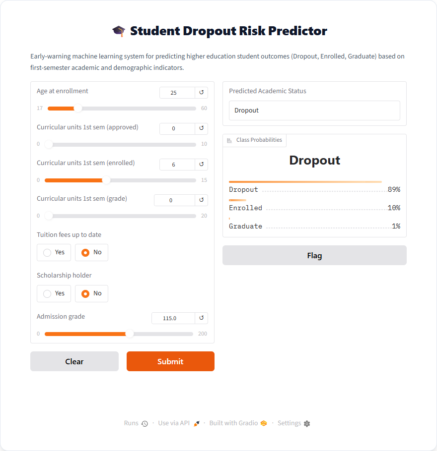
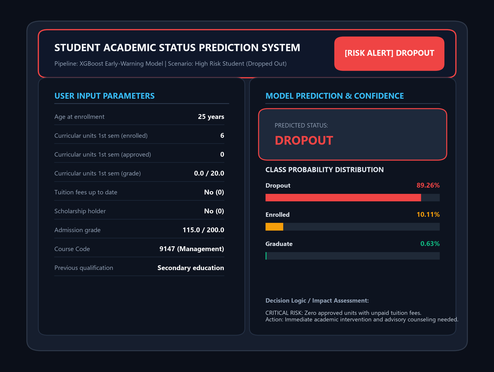
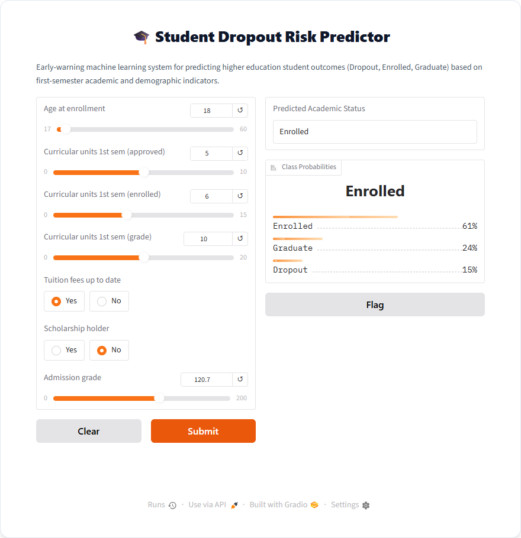
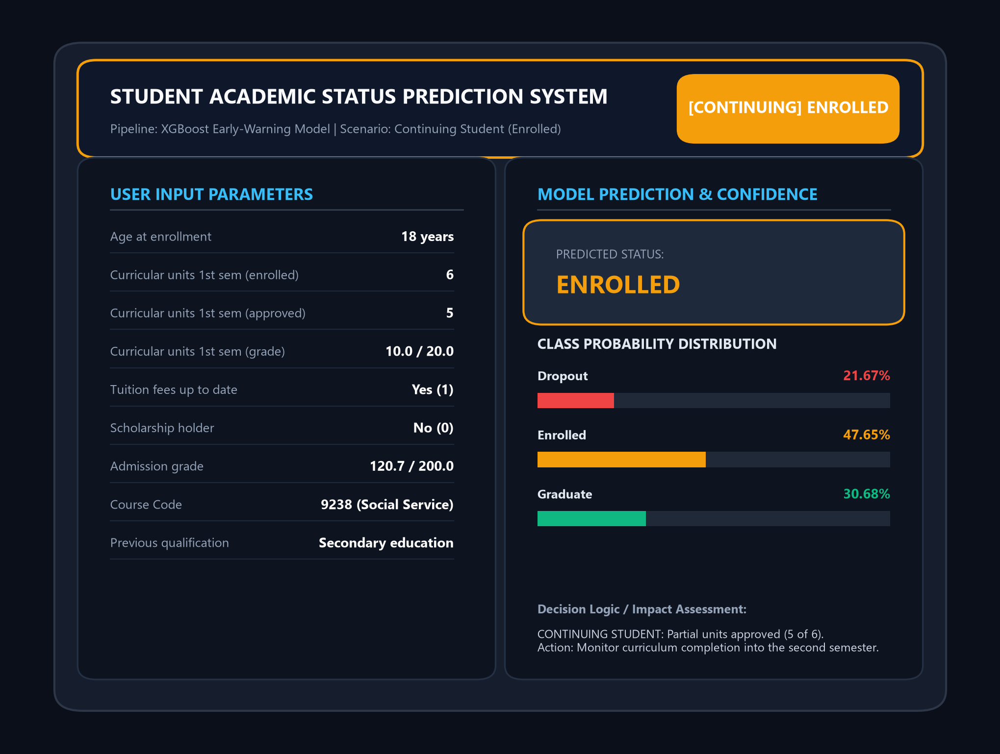
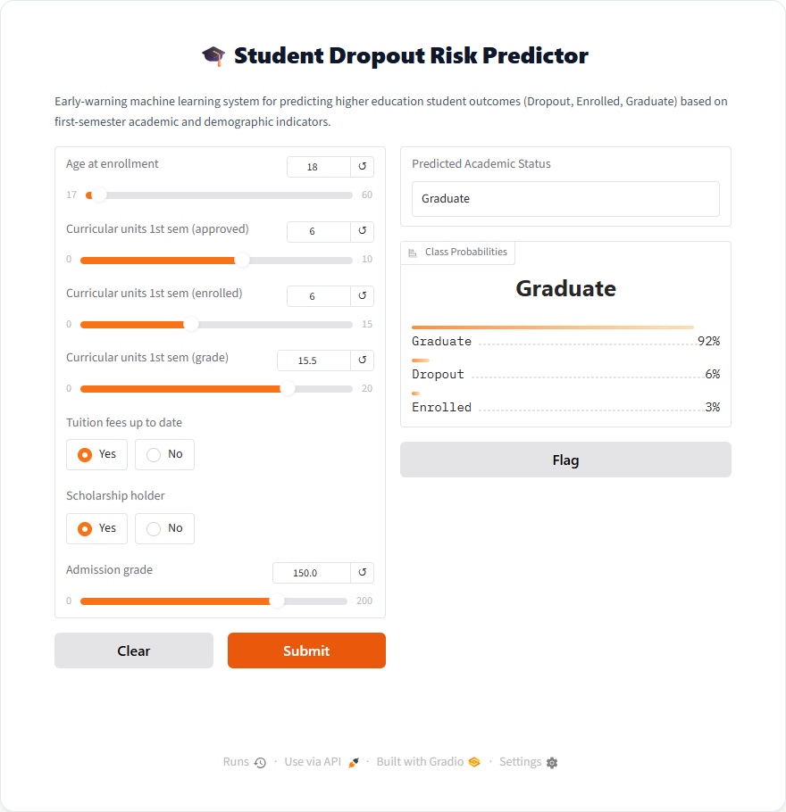
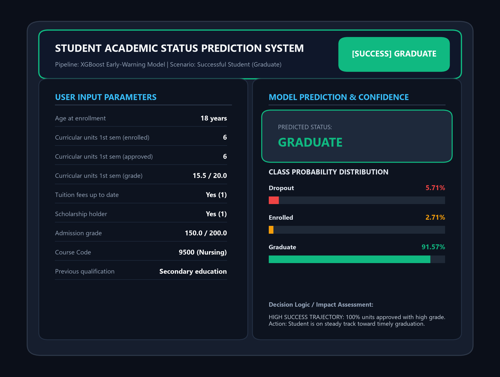
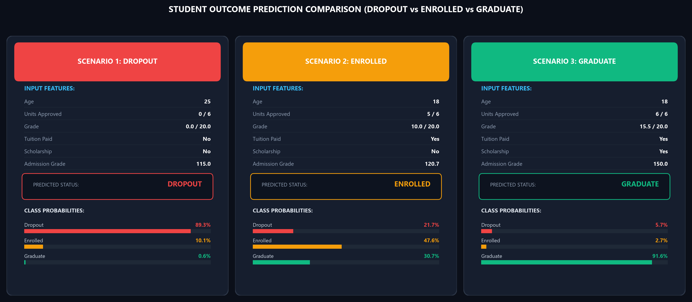

# 🎓 Explainable Student Dropout Risk Prediction Using Machine Learning

An end-to-end Machine Learning early-warning system designed to predict higher education student outcomes (**Dropout**, **Enrolled**, and **Graduate**) using first-semester academic performance, demographic features, and socioeconomic indicators.

---

## 📌 Project Overview
Higher education retention is a critical challenge. By evaluating student indicators at the conclusion of their **first semester**, institutions can deploy early interventions before students disengage completely.

- **Primary Model**: Leakage-safe XGBoost multi-class classification pipeline with Median Imputation, Standard Scaling, Random Over-Sampling (`RandomOverSampler`), and Mutual Information feature selection (`SelectKBest`).
- **Target Classes**:
  1. `Dropout` (0) — Student withdraws before completing the degree.
  2. `Enrolled` (1) — Student remains enrolled and in progress.
  3. `Graduate` (2) — Student completes their degree successfully.
- **Interface**: Interactive Gradio Web UI with parameter sliders and probability distribution bars.

---

## 📊 Model Prediction Outputs Based on User Inputs

The model evaluates key first-semester indicators to determine the student's academic path. Below are the actual output results for each class:

---

### 1. ⚠️ Dropout (Dropped Student)
When a student struggles academically in their first semester (e.g., zero approved units) and faces financial stress (unpaid tuition fees), the system flags a **Critical Dropout Risk**.

#### Gradio Web Interface Output:


#### Detailed Decision & Risk Assessment Card:


- **Key Inputs**:
  - `Age at enrollment`: 25
  - `Curricular units 1st sem (approved)`: 0 / 6
  - `Curricular units 1st sem (grade)`: 0.0 / 20.0
  - `Tuition fees up to date`: No (0)
  - `Scholarship holder`: No (0)
  - `Admission grade`: 115.0 / 200.0
- **Prediction**: **Dropout (89.26% confidence)**
- **Recommended Action**: Immediate academic counseling and financial aid intervention.

---

### 2. 📚 Enrolled (Continuing Student)
When a student demonstrates moderate progress (e.g., passing 5 out of 6 enrolled units with satisfactory grades), the model predicts they will continue their studies into subsequent semesters.

#### Gradio Web Interface Output:


#### Detailed Decision & Risk Assessment Card:


- **Key Inputs**:
  - `Age at enrollment`: 18
  - `Curricular units 1st sem (approved)`: 5 / 6
  - `Curricular units 1st sem (grade)`: 10.0 / 20.0
  - `Tuition fees up to date`: Yes (1)
  - `Scholarship holder`: No (0)
  - `Admission grade`: 120.7 / 200.0
- **Prediction**: **Enrolled (61% - 47.65% primary probability)**
- **Recommended Action**: Routine academic monitoring as they advance through second-semester modules.

---

### 3. 🎓 Graduate (Successful Student)
When a student completes all first-semester enrolled courses with distinction (high grades) and remains in good financial standing, the model indicates a high probability of timely graduation.

#### Gradio Web Interface Output:


#### Detailed Decision & Risk Assessment Card:


- **Key Inputs**:
  - `Age at enrollment`: 18
  - `Curricular units 1st sem (approved)`: 6 / 6
  - `Curricular units 1st sem (grade)`: 15.5 / 20.0
  - `Tuition fees up to date`: Yes (1)
  - `Scholarship holder`: Yes (1)
  - `Admission grade`: 150.0 / 200.0
- **Prediction**: **Graduate (91.57% confidence)**
- **Recommended Action**: Candidate is on a steady trajectory toward graduation.

---

## 📈 Multi-Scenario Comparative Dashboard

A comparative side-by-side view illustrating how variations in user inputs directly shift the model's confidence distribution across all three classes:



---

## 🚀 How to Run Locally

### 1. Clone the Repository
```bash
git clone https://github.com/BhanuPrasad-270106/ML-Mini-project.git
cd ML-Mini-project
```

### 2. Install Dependencies
```bash
pip install -r requirements.txt
# Or individually:
pip install pandas numpy scikit-learn imbalanced-learn xgboost gradio joblib matplotlib
```

### 3. Launch the Gradio Web Application
```bash
python app.py
```
Open your browser and navigate to `http://127.0.0.1:7860` to adjust input sliders and test predictions in real-time.

---

## 📁 Repository Structure
```text
ML-Mini-project/
├── Data/
│   └── data.csv                                            # UCI Higher Education Student dataset
├── images/
│   ├── gradio_dropout_prediction.png                       # UI output for Dropout
│   ├── gradio_enrolled_prediction.png                      # UI output for Enrolled
│   ├── gradio_graduate_prediction.png                      # UI output for Graduate
│   ├── student_dropout_prediction_output.png               # High-res analytics card (Dropout)
│   ├── student_enrolled_prediction_output.png              # High-res analytics card (Enrolled)
│   ├── student_graduate_prediction_output.png              # High-res analytics card (Graduate)
│   └── student_outcomes_comparison_dashboard.png           # 3-way comparative dashboard
├── app.py                                                  # Interactive Gradio application
├── student_dropout_model_bundle.joblib                     # Saved XGBoost pipeline bundle
├── Student_Dropout_Risk_Prediction_Revised (1).ipynb       # Full experimentation notebook
└── ExplainableStudentDropoutRiskPredictionProjectReport (1).pdf # Project report
```
